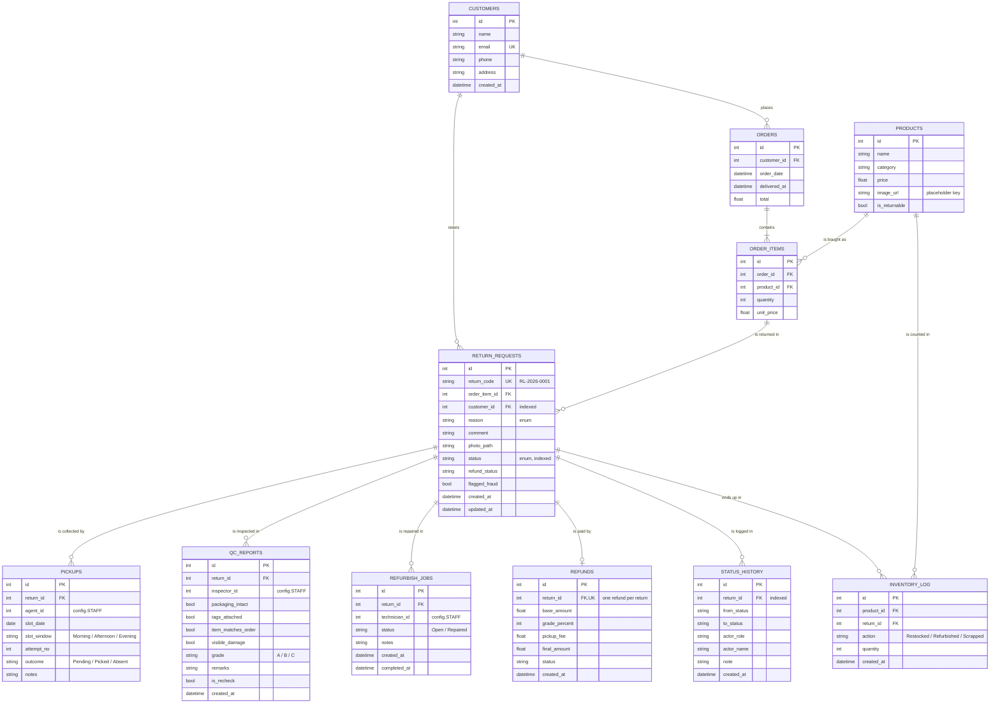

# ReturnLoop: entity-relationship diagram

The schema has 11 tables (see [models.py](../models.py)). Staff (agents, inspectors, technicians) are not stored in a table. They are listed in `config.STAFF`, so `agent_id`, `inspector_id` and `technician_id` are plain integers, not foreign keys.

## Notes

- **Indexes:** `return_requests.status`, `return_requests.customer_id` and `status_history.return_id`, as the spec requires. The unique columns (`customers.email`, `return_requests.return_code`, `refunds.return_id`) are also indexed.
- **One refund per return:** `refunds.return_id` is `UNIQUE`, so the database enforces it as well as `services/refund.py`.
- **`return_requests.customer_id`** duplicates `orders.customer_id` (reachable through `order_items`). It is kept because the spec lists it, and it makes "my returns" and the frequent-returner count simple queries.
