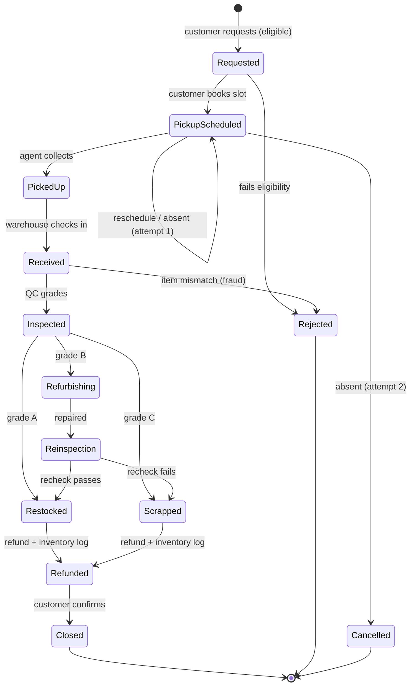
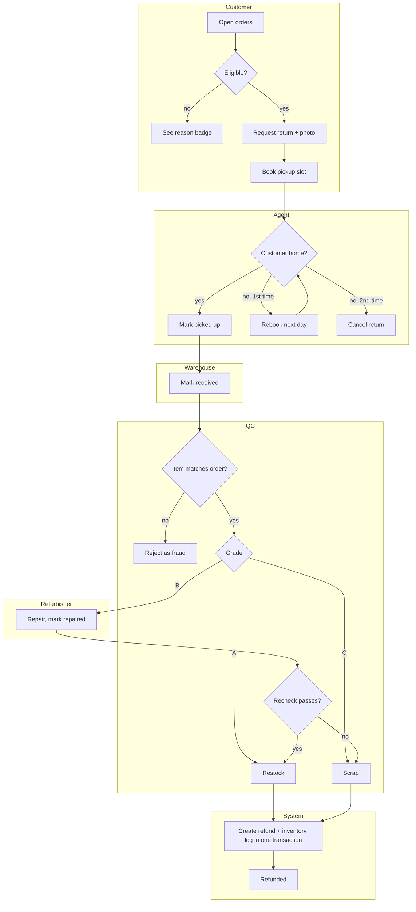

# ReturnLoop: mapping the app to UML diagrams

This table shows where each UML diagram comes from in the code, so a diagram can be drawn (or checked) straight from the source.

| UML diagram | What it shows | Where it comes from in the app |
|---|---|---|
| **Use case diagram** | Actors and what each can do | The six roles are the actors (`config.ROLES`). Their use cases are the routes in each blueprint (below). |
| **Class diagram** | Entities, attributes, associations | `models.py`: 11 classes with their columns and `db.relationship` links. The service modules (`services/*.py`) can be drawn as control classes. See also [ER.md](ER.md). |
| **State machine diagram** | Lifecycle of a return | `services/state_machine.py`: the 13 statuses (`ALL_STATUSES`) and the `TRANSITIONS` table. Each transition's trigger is the workflow function that calls `change_status()`. |
| **Activity diagram** | The end-to-end return process, with decisions | `services/returns.py`: the decisions are the eligibility check, absent attempts, fraud check, grade routing, and recheck pass/fail. |
| **Swimlane (activity with partitions)** | The same process split by who does each step | One lane per role: Customer → Agent → Warehouse → QC → Refurbisher → QC → System (refund). This is the README demo script. |
| **Sequence diagram** | Messages between objects for one scenario | For example, "QC submits grade A": Browser → `qc.inspect` → `submit_inspection()` → `change_status()` ×2 → `issue_refund()` → DB commit → redirect. |
| **Component / deployment** (optional) | How the pieces fit | Flask app (blueprints and services) + SQLite file + static assets. The browser loads Three.js, GSAP and Chart.js from CDNs. |

## Use cases per actor

| Actor | Use cases | Route / function |
|---|---|---|
| Customer | View orders and eligibility | `GET /customer/orders` → `check_eligibility()` |
| | Request a return (reason, comment, photo) | `POST /customer/return/new` → `create_return()`, `save_photo()` |
| | Schedule / reschedule a pickup | `POST /customer/return/<code>/schedule` → `schedule_pickup()` |
| | Track a return (live) | `GET /customer/return/<code>`, `GET /api/return/<code>/status` |
| | Close a refunded return | `POST /customer/return/<code>/close` → `close_return()` |
| Pickup agent | See today's pickups | `GET /agent/pickups` |
| | Mark picked up / customer absent | `POST /agent/pickup/<id>` → `mark_picked_up()` / `mark_absent()` |
| Warehouse manager | Receive a parcel | `POST /warehouse/receive/<code>` → `mark_received()` |
| | View inventory outcomes | `GET /warehouse/inventory` |
| QC inspector | Search the queue | `GET /qc/queue?q=` |
| | Inspect and grade (or reject as fraud) | `POST /qc/inspect/<code>` → `submit_inspection()` |
| | Re-inspect a repaired item | same route, when status is Re-inspection |
| Refurbisher | Mark a job repaired | `POST /refurb/jobs/<id>/repaired` → `mark_repaired()` |
| Admin | View dashboard and flagged customers | `GET /admin/dashboard` → `dashboard_stats()`, `flagged_customers()` |
| All | Switch role / user | `POST /switch` |

## State machine (copy into a state diagram)



## Sequence: QC grades a return B, then rechecks it

```mermaid
sequenceDiagram
    actor QC as QC inspector
    participant R as qc blueprint
    participant W as services.returns
    participant S as services.state_machine
    participant F as services.refund
    participant DB as SQLite
    QC->>R: POST /qc/inspect/RL-2026-0010 (checklist, grade B)
    R->>W: submit_inspection(ret, checklist, "B")
    W->>S: change_status(Received → Inspected)
    W->>S: change_status(Inspected → Refurbishing)
    W->>DB: insert qc_report, refurbish_job, 2× status_history; commit
    R-->>QC: redirect to queue + toast
    Note over QC,DB: refurbisher marks repaired → Re-inspection
    QC->>R: POST /qc/inspect/RL-2026-0010 (grade B = passed)
    R->>W: submit_inspection(ret, checklist, "B")
    W->>S: change_status(Re-inspection → Restocked)
    W->>F: issue_refund(ret, "Refurbished")
    F->>F: calculate_refund(base, B, reason) → 70%
    F->>S: change_status(Restocked → Refunded)
    F->>DB: insert refund + inventory_log + history; ONE commit
    R-->>QC: redirect + toast
```

## Activity / swimlane: the demo flow


